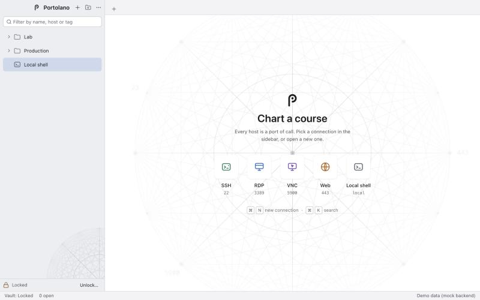
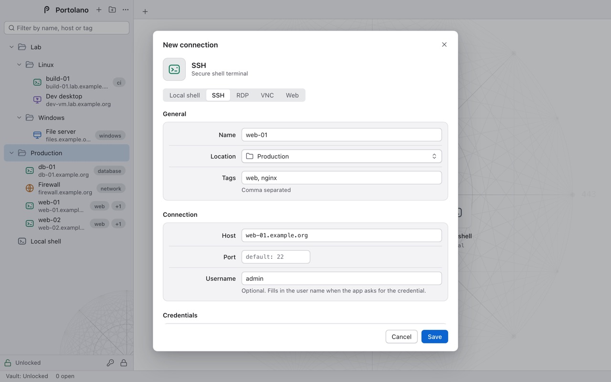
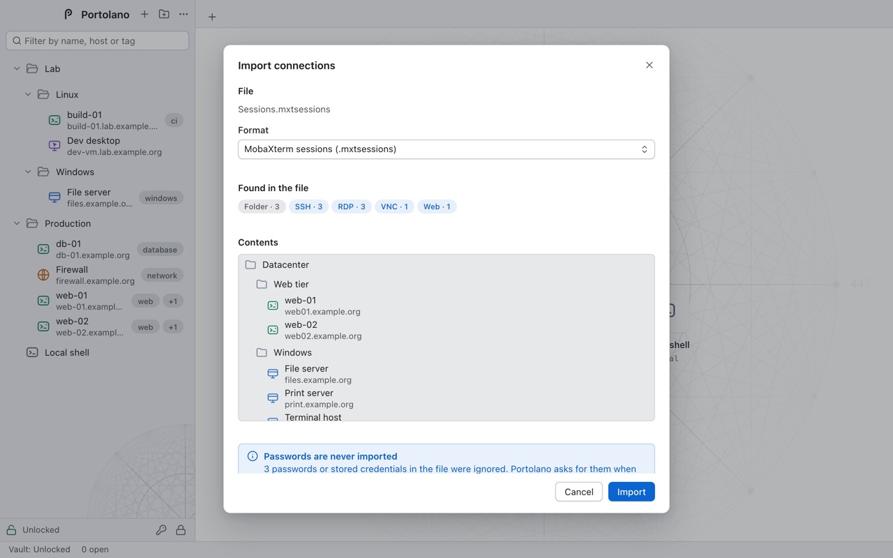
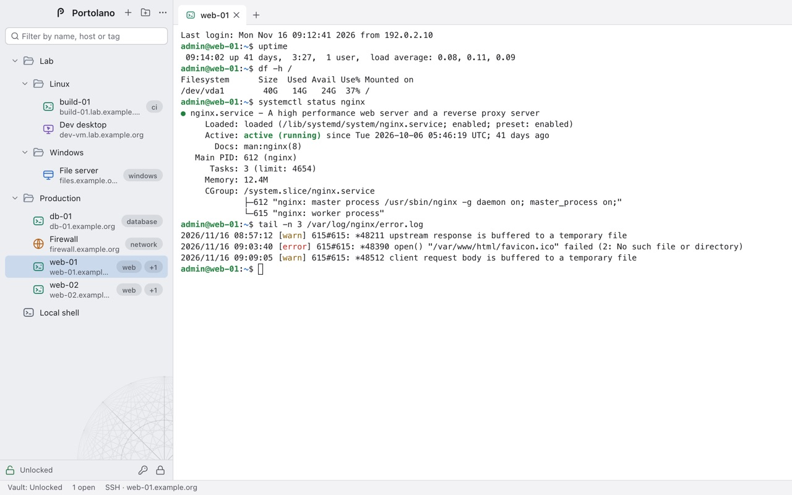

<p align="center">
  
</p>

<h1 align="center">Portolano</h1>

<p align="center">
  <strong>One window for every remote connection.</strong><br>
  SSH, RDP, VNC, web consoles and local shells — in tabs, with an encrypted vault.
</p>

<p align="center">
  
  
  
  
  
  
  
</p>

<p align="center">
  <picture>
    <source media="(prefers-color-scheme: dark)" srcset="docs/screenshots/welcome-dark.jpg">
    
  </picture>
</p>

## What "portolano" means

A *portolano* (portolan, in English) was the pilot book of medieval Mediterranean
sailors: a list of ports, the routes between them, and what you needed to know to reach
each one safely. The charts drawn from those books are covered in straight lines radiating
from compass points — the pattern in the background of the app.

This application is that book for system administrators: every host you look after, and
the shortest route to each one. (*Porte* are also network ports.)

## Why it exists

I have wanted an application like this for years. On Windows there is MobaXterm; on
macOS the alternatives are few and the good ones are subscriptions. I never had the
time or the Rust experience to build it myself.

Portolano exists because AI made it possible. **It was built with AI assistance, and
I want to say so plainly:** the design, the code and the tests were produced by
Anthropic's Claude (the Fable model, coordinating smaller sub-agents for individual
packages), working under my direction, with me deciding what to build, reviewing the
results and testing the application on real machines.

It is free, open source, and open to collaboration: if you find a problem, tell me, or
fix it and send a pull request.

## What it does

- **SSH and local shells** in a real terminal: password or key authentication,
  jump hosts, host-key verification.
- **RDP** with Network Level Authentication and remote cursor.
- **VNC**, with password authentication, and TLS encryption (VeNCrypt) when the
  server provides a certificate.
- **Web** consoles in tabs, optionally each with its own isolated cookie store.
- **A tree of folders and connections**, with search, tags, drag and drop, and
  credentials inherited from the parent folder.
- **An encrypted vault** for credentials — optional: with no credential assigned,
  Portolano simply asks when you connect.
- **Import** from OpenSSH config, `.rdp` files, MobaXterm, mRemoteNG and CSV;
  **export** to JSON and `.rdp`.
- Light and dark themes that follow the system.

<p align="center">
  <picture>
    <source media="(prefers-color-scheme: dark)" srcset="docs/screenshots/connection-editor-dark.jpg">
    
  </picture>
  <picture>
    <source media="(prefers-color-scheme: dark)" srcset="docs/screenshots/import-dark.jpg">
    
  </picture>
  <picture>
    <source media="(prefers-color-scheme: dark)" srcset="docs/screenshots/terminal-dark.jpg">
    
  </picture>
</p>

## Security

A tool that holds the keys to your servers has to earn trust. Portolano is written in Rust on
established open-source implementations, with no home-made cryptography:

| Area | Implementation |
|---|---|
| SSH | [`russh`](https://github.com/Eugeny/russh), a pure-Rust SSH client |
| RDP | [IronRDP](https://github.com/Devolutions/IronRDP) by Devolutions |
| TLS and vault | [`rustls`](https://github.com/rustls/rustls); [RustCrypto](https://github.com/RustCrypto) `argon2` and `chacha20poly1305` |

**How the vault is encrypted.** Your master password is never stored. It is stretched with
**Argon2id** (64 MiB of memory, 3 passes for new vaults) into a key that exists only in
memory. Credentials are encrypted with **XChaCha20-Poly1305**, an authenticated cipher: a
vault file tampered with, even by a single bit, is rejected rather than decrypted. A random
256-bit data key encrypts the vault and is itself wrapped by the password-derived key, so
changing the master password creates a new data key and encrypts the vault again (a copy
made before the change still opens with the old password). Every save uses a fresh nonce and
replaces the file atomically. The vault locks after a chosen period of inactivity (15 minutes
by default; 5, 30 or 60 minutes, or never, can be set in the Security section of the
credentials window), counting time spent asleep, and when the application quits. Keys and
decrypted secrets are zeroed on lock. Optionally, quick unlock reopens the vault with Touch ID
(macOS) or Windows Hello (Windows) after you have unlocked it once with the master password,
which always works too. Quick unlock keeps the vault key in Portolano's memory while the app
is open; quit the app to require the master password again.

**Connections and files.**

- Secrets stay in the Rust core: the interface asks the core to connect and never receives
  a stored password unless you explicitly reveal one. Connections and credentials live in
  separate files, and the connection list contains no secrets.
- Imports never bring passwords in: every imported entry starts with no credential, the
  certificate check on and NLA required, and local-shell entries naming a program are not
  imported. The preview lists what was changed. Exports never contain passwords.
- SSH host keys and RDP/VNC certificates are confirmed on first use (certificates are pinned
  by SHA-256 fingerprint, and the server must prove it owns its certificate). If one
  **changes**, Portolano refuses until you remove the stored one: no "connect anyway".
- RDP requires Network Level Authentication when a password is sent; a TLS-only server is
  refused unless you turn on "Allow connections without NLA" for that connection.
- A VNC host that has used TLS is never downgraded. For a server without TLS, Portolano asks
  before sending the password, once per host, and a banner says the session is not encrypted.
- Copied secrets are cleared from the clipboard after 30 seconds if it still holds them
  (when the system lets the app read it). Web pages in tabs cannot call into the app.
- On macOS the data folder is readable only by your user; on Windows it inherits the
  profile's permissions. No telemetry, no account, no cloud. Besides the hosts you connect to,
  the app contacts GitHub to look for updates and read the release notes (nothing about you
  is sent, and the automatic check can be turned off in the settings); the Windows installer
  may download Microsoft's WebView2 runtime.

**Honest limits.** A weak master password makes a weak vault, and malware running as your
user is beyond what a local password manager can defend against. Locking does not wipe the
secrets of sessions already open: they stay in memory until the session closes. Plain VNC is
not encrypted. The `rsa` crate has an advisory (RUSTSEC-2023-0071) with no fixed release yet,
recorded in [`deny.toml`](deny.toml). The code was reviewed with AI assistance, by automated
AI agents whose findings were fixed before publication; it has not had an independent
security audit. More in [SECURITY.md](SECURITY.md).

## Status

Portolano is in **alpha**: developed and tested on macOS; the Windows build shares the
code but has had far less testing. Expect rough edges, and please report them.

## Download

Builds for macOS (14 or later; Apple silicon and Intel) and Windows 10/11 (64-bit) are on the
[Releases page](https://github.com/reallovedone/portolano/releases). They are **not signed**
(I have no Apple Developer ID or Windows certificate), so both systems warn you the first
time. Check the file against `SHA256SUMS.txt` if you want to be sure.

- **macOS:** open the `.dmg`, drag Portolano to Applications, then right-click it and choose
  *Open* (and *Open* again in the dialog). If macOS still refuses, open *System Settings →
  Privacy & Security* and press *Open Anyway*. Alternatively, run
  `xattr -dr com.apple.quarantine /Applications/Portolano.app` once.
- **Windows:** run the `-setup.exe`. When SmartScreen says "Windows protected your PC", press
  *More info*, then *Run anyway*.

**Updates.** From 0.2.0 Portolano checks GitHub for a newer release and, only if you agree,
downloads, verifies and installs it, then restarts (*Check for updates…* does it on demand;
the automatic check can be switched off in the settings). Updates are verified with a signing
key of the project, which is separate from the system code signing: the builds stay unsigned,
but updated copies do not bring the first-launch warning back. If you have 0.1.0, install
0.2.0 by hand once. What changed in each version is in the [changelog](CHANGELOG.md).

## Building from source

You need [Rust](https://rustup.rs), [Node.js](https://nodejs.org) and
[pnpm](https://pnpm.io).

```bash
git clone https://github.com/reallovedone/portolano.git
cd portolano
pnpm install
pnpm ui:install
pnpm dev        # run in development
pnpm build      # optimised build
```

Your data is stored in the operating system's application-data folder
(`~/Library/Application Support/portolano` on macOS), never inside the repository.

To work on the interface without a backend, `pnpm dev:mock` serves it with demo data.

## Contributing

Issues, ideas and pull requests are welcome. Before sending code, run the full
check suite:

```bash
bash dev/check.sh
```

It runs formatting, linting, and the Rust and interface tests. Some integration tests use
local SSH, RDP and VNC servers in Docker (`bash dev/servers.sh up`) and skip themselves
when those are not running.

If you have found a security problem, please report it privately, as described in
[SECURITY.md](SECURITY.md), rather than in a public issue.

## License

[MIT](LICENSE) © Simone Amato
